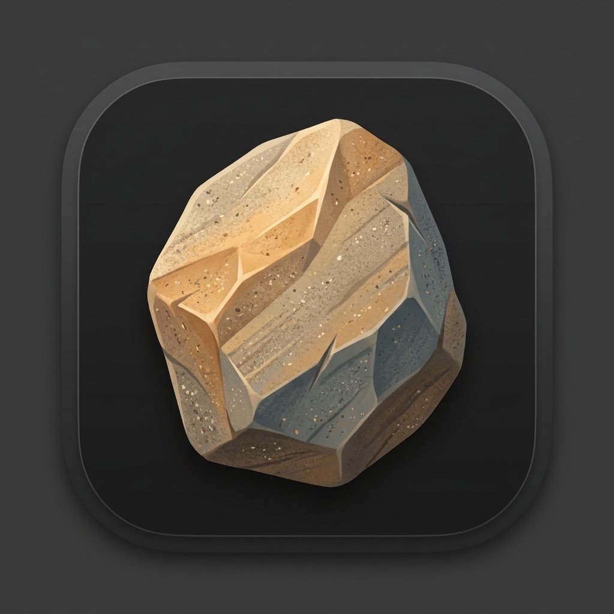

<p align="center">
  
</p>

<h1 align="center">Gritty</h1>

<p align="center">
  A minimal, CPU-rendered C++23 terminal built for <code>tmux</code> on Apple Silicon macOS.
</p>

On Linux I am a daily [`foot`](https://codeberg.org/dnkl/foot) user — it is one of the best terminals ever written, and it proved to me that a well-engineered CPU terminal can be faster, lighter, and sharper than most hardware-accelerated ones. When I saw [`foot-macos`](https://github.com/gobijan/foot-macos), it gave me the idea to build Gritty: a native C++23 companion for `tmux` on Apple Silicon macOS, bringing `foot`-style crisp text and low latency without Metal/OpenGL shaders or CoreText's blurry font smoothing.

It uses CoreText only to find font files and fallbacks. Everything else — glyph rasterization (FreeType2), shaping (HarfBuzz), compositing (Pixman), and buffer management (`IOSurface`) — happens directly on the CPU.

Because `tmux` already handles panes, tabs, scrollback, search, copy mode, and reflow well, Gritty deliberately implements none of them. Right now only **Apple Silicon macOS (`arm64`)** has a window backend (Intel macOS is unsupported, and a Linux/Wayland backend has not been written yet).

## Installation

### Homebrew (macOS Apple Silicon)

Install `Gritty.app` and the `gritty` CLI binary from GitHub Releases via the in-repo cask ([Casks/gritty.rb](Casks/gritty.rb)):

```sh
brew tap levinion/gritty https://github.com/levinion/gritty
brew install --cask gritty
```

### From source (macOS, without Nix)

Requires Apple Silicon macOS with Xcode Command Line Tools (`clang++` with C++23 support) and [Homebrew](https://brew.sh) dependencies:

```sh
brew install meson ninja pkg-config pixman freetype harfbuzz utf8proc libpng
# Optional, if you want to build and run the test suite:
brew install doctest tmux
```

Clone, build, and launch:

```sh
git clone https://github.com/levinion/gritty.git && cd gritty
meson setup build/release --buildtype=release -Db_lto=true -Dtests=false
meson compile -C build/release gritty
./build/release/src/gritty
```

To bundle a signed local `Gritty.app` (`dist/Gritty.app`), run [packaging/macos/package.sh](packaging/macos/package.sh) after building.

### With Nix

Run directly from the flake without cloning:

```sh
nix run github:levinion/gritty
```

Or build locally after cloning (`nix build`, or using [tools/build.sh](tools/build.sh) which enters the Nix devShell and manages `build/release` and `build/debug` automatically):

```sh
git clone https://github.com/levinion/gritty.git && cd gritty
nix build
./result/bin/gritty
# or:
./tools/build.sh release build
./tools/build.sh release run
```

## Features

- **100% CPU Rendering**: Renders into CPU-mapped `IOSurface` Pixman buffers (`BGRA`) with FreeType2 + HarfBuzz shaping and procedural box/block drawing — no Metal, OpenGL, or CoreText rasterization (CoreText is used strictly for font/fallback discovery).
- **Low-Latency Frame Pipeline**: Dirty-row damage tracking, row-index scroll rotation (`DECSTBM` in `O(1)`), `memmove` scroll blitting, ARM64 NEON fast paths, and 2 ms frame coalescing over a single-threaded `kqueue` loop.
- **Native macOS Integration**: Single Dock icon with independent windows, Retina scaling, IME inline preedit, per-window font zoom, and optional `Cmd+Q` quit confirmation (`window.confirm_quit`: `"needed"` / `"always"` / `"never"`).
- **`tmux`-First Non-Goals**: Deliberately omits built-in scrollback, resize reflow, copy/selection mode, search overlays, tabs, splits, daemon mode, and Sixel — `tmux` handles those.

### Protocol & Terminal Support

| Category | Supported |
|---|---|
| **Text & Colors** | 24-bit truecolor (`38;2` / `48;2` & colon syntax), 256-color palette, styled & colored underlines (`CSI 4:0..5 m` / `Smulx`, `CSI 58 m` / `Setulc`), `DECSCNM` reverse video (`DECSET 5`), procedural box/Braille drawing, color emoji, `DECSET 2027` Unicode grapheme clustering (`libutf8proc` + HarfBuzz) |
| **Cursor & Screen** | `DECSCUSR` cursor shapes/blink, synchronized updates (`DECSET 2026`), `DECSET 2031` + `CSI ? 996 n` dark/light color-scheme reporting, `DECSET 2048` in-band resize notifications, `XTWINOPS` (`14/16/18t` size queries & `22/23t` title stack), `XTSAVE`/`XTRESTORE` (`CSI ? Pm s/r`), `BEL` unfocused Dock attention |
| **Keyboard & Mouse** | Kitty Keyboard (`CSI u`), XTerm `modifyOtherKeys`, bracketed paste (`DECSET 2004`), focus events (`DECSET 1004`), mouse tracking (`X10` / `1000` / `1002` / `1003` with `Normal` / `UTF-8 1005` / `SGR 1006` / `URXVT 1015` / `SGR-Pixels 1016`), Alternate Scroll Mode (`DECSET 1007`) |
| **Queries & `tmux`** | `XTVERSION`, `XTGETTCAP` (`RGB`, `Tc`, `Sync`, `Ms`, `Smulx`, `Setulc`), `DECRQM`, `DECRQSS` (`r` margins, `m` SGR, ` q` cursor style), `tmux` DCS passthrough |
| **Graphics** | Kitty Graphics (`APC G` — `a=t/T/p/d/q`, `f=24/32/100` PNG, `o=z`, `t=d/f/t`, source crops, z-layers, `U=1` Unicode placeholders); Sixel omitted |

### Supported OSC Sequences

| OSC | Purpose | Notes |
|---|---|---|
| `0`, `2` | Window title | Updates native macOS window title |
| `4`, `104` | 256-color palette | Query (`?`), set, or reset individual / all palette entries |
| `7` | Current working directory | Local `file://` URL validation |
| `8` | Hyperlinks | Clickable via `Cmd+Click` when mouse reporting is off |
| `9` | Desktop notification (iTerm2) | Ignores ConEmu `OSC 9;4;...` progress sequences |
| `10`, `11`, `12` / `110`, `111`, `112` | Default fg, bg, cursor color | Query/set/reset with `;` chaining; preserves window alpha |
| `22` | Mouse pointer shape | `text`, `pointer`, resize arrows, `crosshair`, `move`, `not-allowed`, `none`, etc. |
| `52` | Clipboard | `OnlyCopy` by default (`Disabled` / `OnlyCopy` / `OnlyPaste` / `CopyPaste`, up to 1 MiB) |
| `99` | Desktop notification (Kitty) | `p=?` query, `p=title`/`body`, `d=0/1` chunking, `e=1` base64 |
| `777` | Desktop notification (urxvt/VTE) | `notify;title;body` via macOS UserNotifications |

## Shortcuts (macOS)

| Shortcut | Action |
|---|---|
| `Cmd+N` | Open a new independent window |
| `Cmd+W` | Close the focused window (closing the last window exits) |
| `Cmd+Q` | Quit Gritty (double-press confirmation via `window.confirm_quit`) |
| `Cmd+V` | Paste from system clipboard (respects `DECSET 2004` bracketed paste) |
| `Cmd+=` / `Cmd++` | Zoom in (per-window font size `+1pt`) |
| `Cmd+-` | Zoom out (per-window font size `-1pt`) |
| `Cmd+0` | Reset font size to configured default |
| Trackpad Pinch | Zoom font size in/out per window |
| `Cmd+Click` | Open `OSC 8` hyperlink (when mouse reporting is off) |
| `Ctrl+Cmd+F` | Toggle native full screen |
| `Cmd+M` | Minimize window |
| `Cmd+H` / `Option+Cmd+H` | Hide Gritty / Hide Others |

## Using with `tmux`

*(Gritty defaults `TERM` to `xterm-256color` and answers `XTVERSION` / `XTGETTCAP` directly.)*

Add this to `~/.tmux.conf` to enable passthrough images, clipboard sync, styled underlines, and extended keys inside `tmux`:

```tmux
set -g allow-passthrough on
set -g set-clipboard on
set -g extended-keys on
set -as terminal-features ',xterm-256color:RGB:extkeys:usstyle'
```

Launch Gritty directly into a named `tmux` session (attach if `main` exists, otherwise create it):

```sh
gritty -e tmux new -As main
```

## Configuration and CLI

Gritty looks for a config file at `--config-file` (or `-c`), then `$XDG_CONFIG_HOME/gritty/config.toml`, then `~/.config/gritty/config.toml`. With no config file, it defaults to `Menlo` at `11.25pt` (`72 DPI` on macOS, matching Alacritty's default sizing), an `800×600` centered window, opaque `#111111` background, full titlebar, and zero padding.

Here is a minimal `~/.config/gritty/config.toml` (see [examples/config.toml](examples/config.toml) for all keys):

```toml
[terminal]
osc52 = "OnlyCopy" # Disabled | OnlyCopy | OnlyPaste | CopyPaste

# Optional explicit shell:
# [terminal.shell]
# program = "/bin/zsh"
# args = ["-l"]

[font]
normal = { family = "Menlo" }
size = 11.25
dpi = 72              # 72 on macOS to match CoreText; 96 on Linux
antialias = "grayscale" # grayscale | subpixel | none

[window]
decorations = "Full" # Full | None | Transparent | Buttonless
padding = { x = 6, y = 4 }

[platform.macos]
font = { normal = { family = "JetBrainsMono Nerd Font" }, size = 12.0 }
```

Common CLI flags (`gritty --help` for the full list):

- `-e <cmd> [args...]` (or `--`) — run a command instead of your login shell
- `-f <family>`, `-s <pt>` — override font family and size
- `-o <key=value>` — override any config key (repeatable, e.g. `-o window.padding=8`)
- `--config-file <path>` (`-c`) — use a specific TOML file
- `--cols <n>`, `--rows <n>` — initial grid size (defaults to `800×600` logical points when unset / `0`)
- `--working-directory <dir>` (`--cwd`), `-T <title>`, `--class <id>`, `--hold`, `--standalone`

## Benchmarks

Running [`alacritty/vtebench`](https://github.com/alacritty/vtebench) on Apple Silicon macOS (`160×48`, 2× Retina) with empty default configs on both terminals (`Menlo 11.25pt`; Gritty `14×27` px cells vs Alacritty `13×26` px cells):

| Workload | Gritty (ms) | Alacritty (ms) | Ratio |
|---|---:|---:|---:|
| `cursor_motion` | **70.0** | 81.0 | 0.86x |
| `dense_cells` | **68.0** | 93.5 | 0.73x |
| `light_cells` | **101.0** | 109.5 | 0.92x |
| `scrolling` | **192.0** | 275.5 | 0.70x |
| `scrolling_bottom_region` | **214.5** | 807.0 | 0.27x |
| `scrolling_bottom_small_region` | **199.0** | 996.0 | 0.20x |
| `scrolling_fullscreen` | **89.5** | 135.5 | 0.66x |
| `scrolling_top_region` | **211.5** | 485.0 | 0.44x |
| `scrolling_top_small_region` | **196.0** | 317.5 | 0.62x |
| `unicode` | 117.5 | **105.5** | 1.11x |

Median over 20 runs (`n=12`/`10` for Alacritty's slowest region cases). Reproduce with:

```sh
python3 benchmark/run.py --targets gritty,alacritty
```

A quick caveat on why the gap is so large, especially on partial scroll regions: Gritty carries zero scrollback history (delegated to `tmux`), rotates a `uint16_t` row index table instead of moving cells during `DECSTBM` scrolls, scans ASCII with ARM64 NEON, and runs a single-threaded `kqueue` loop with 2 ms frame coalescing instead of synchronizing a separate PTY/render thread with a 10k-line history ring. On heavy non-CJK `unicode` streams where Gritty falls back to `utf8proc` and FreeType glyph loads, Alacritty edges ahead.

## Development

Run the headless unit suite and real `tmux` PTY integration tests (requires `doctest` and `tmux`):

```sh
# Using the Nix devShell wrapper
./tools/build.sh debug test
./tools/build.sh release test

# Or directly with Meson (without Nix)
meson test -C build/release --print-errorlogs
```

Code layout:

```text
src/
├── config/          # TOML loader (tomlc17), AppConfig, CLI parser
├── core/            # TerminalSession, TerminalEngine, ScreenGrid, VtParser, Kitty graphics
├── input/           # Key/mouse mapping (xterm + Kitty CSI u + SGR mouse)
├── render/          # FreeType2/HarfBuzz FontEngine, BoxDrawingRenderer, Pixman CpuRenderer
├── platform/macos/  # Cocoa window, IOSurface pool, kqueue loop, CoreText finder, IME
└── util/            # Move-only RAII wrappers, base64, formatting
tests/               # doctest unit tests + real tmux integration suite
benchmark/           # alacritty/vtebench harness (benchmark/run.py)
```

## Note on AI

Gritty is a personal experimental project, and all code in this repository was written by AI. While it includes unit tests, real `tmux` integration tests, and benchmarks, please keep that context in mind before relying on it in production.

## Acknowledgments

- [`foot`](https://codeberg.org/dnkl/foot) and `fcft` — an extraordinary terminal that proved a CPU-rendered emulator can outperform most GPU-accelerated terminals in speed, footprint, and font clarity. Gritty owes its Pixman + FreeType/HarfBuzz pipeline, damage tracking, and scroll-blitting model directly to `foot`.
- [`foot-macos`](https://github.com/gobijan/foot-macos) — for sparking the idea behind this project in the first place and serving as an important reference for the macOS client and `IOSurface` presentation layer.
- [`alacritty`](https://github.com/alacritty/alacritty) and [`vtebench`](https://github.com/alacritty/vtebench) for the throughput benchmark suite and default sizing reference.
- [`kitty`](https://sw.kovidgoyal.net/kitty/) for the keyboard (`CSI u`) and graphics protocol specifications.
- Core libraries and tools: Pixman, FreeType, HarfBuzz, utf8proc, libpng, zlib, [`tomlc17`](https://github.com/cktan/tomlc17), and `doctest`.

## License

Gritty is licensed under the [GNU General Public License v3.0](LICENSE).
